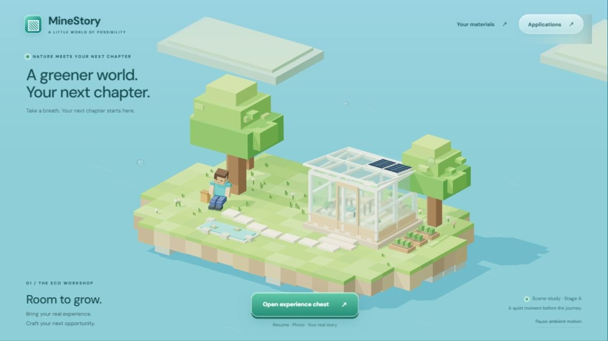
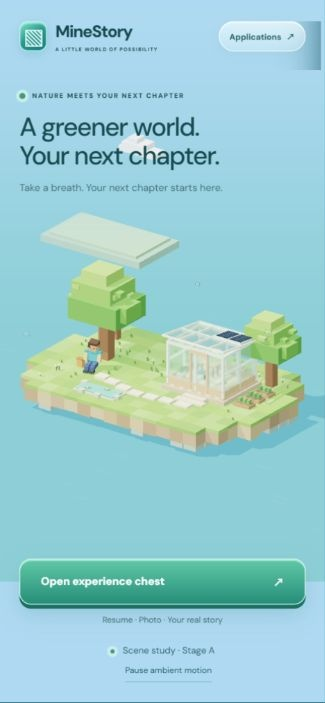

# MineJob · Stage A scene verification

Date: 2026-10-10. Historical branch: `codex/minestory-stage-a`.

## Implemented at this stage

- Native Three.js scene with a fixed elevated orthographic camera, block island shoreline, grass, trees, flowers, pond and stepping stones.
- Original block character resting under a tree, with closed eyes, bent knees, a tilted head and subtle breathing; no standing or walking yet.
- Timber/glass eco cabin with reflections, transmission, solar panels, interior furniture, plants and lights. Solar panels are decorative.
- Bright water, soft sunlight shadows, block clouds and floating glass bubbles; subtle foliage, water and cloud animation.
- One render loop, DPR capped at 1.5. Hidden pages or business views stop rendering and restore it on return. Reduced motion defaults to paused; users can pause/resume.
- `/` and `#scene` show the scene. `#profile` and `#workspace` retain materials and drafts without reloading. HTML forms remain accessible after WebGL/module failure.
- Corrected a materials-panel overflow at 1200px width by placing it beside the chest.

The stage did not add interactive business models, movement, accounts, interior transitions or backend requests. Existing workflows and fields were preserved. No backend changes, push, merge or deployment occurred at that stage.

## Browser checks

Windows Codex in-app browser; mobile sizes were simulated CSS viewports, not physical phones. Screenshots only trimmed browser-generated margins outside the page.

| Viewport | Observation |
| --- | --- |
| 1200 × 750 | Scene and upload panel fit; five supporting slots; Start crafting disabled without material; Esc closes the panel. |
| 1366 × 768 | Character, cabin, glass, solar panels and shoreline visible; no title obstruction or horizontal overflow. |
| 390 × 843 | Scene, controls and navigation fit; pause/resume works; no horizontal overflow. |

The workbench initially contained one `default` application. A temporary title/description survived navigation back to the scene. No real upload or generation request was sent.

A two-second desktop sample showed about 60 FPS and 1460–1461 draw calls, including glass transmission. These were observations on that machine, not performance guarantees. Instancing and transparency optimization remained future work. Pause was tested; system preferences were not changed to simulate reduced motion.

No scene console errors were observed. Production build and `node tests/workspace.test.mjs` passed, covering original workflows and state retention.

## Assets

| Asset | Source and use |
| --- | --- |
| Island, character, trees, cabin, flowers, pond, solar panels, bubbles and clouds | Original procedural geometry/materials in `src/eco-scene.js`; no downloaded models or skins. |
| Three.js 0.180.0 / RoomEnvironment | Official npm package, MIT; generated environment reflections, with license copied to `vendor/THREE-LICENSE.txt`. |
| DM Sans / Press Start 2P | Existing Google Fonts links; Arial/monospace fallbacks offline. |
| Original background, chest PNGs and wood textures | Retained for the original form view, not referenced by the new 3D scene. |

Stage B was planned to add waking, standing, walking and entry before Stage C connected business objects. Real upload, generation and download still required backend integration.
