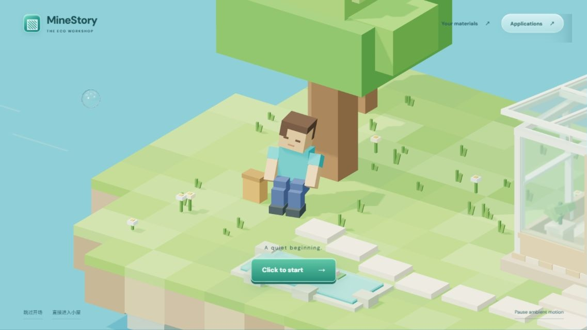
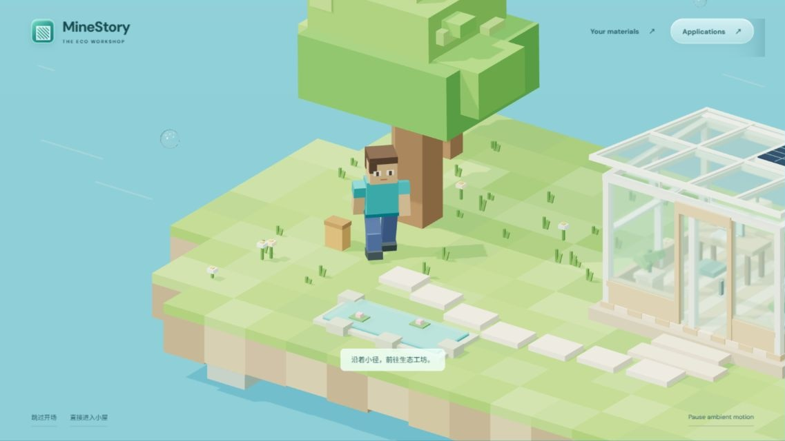
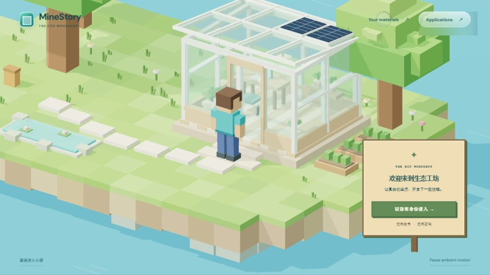
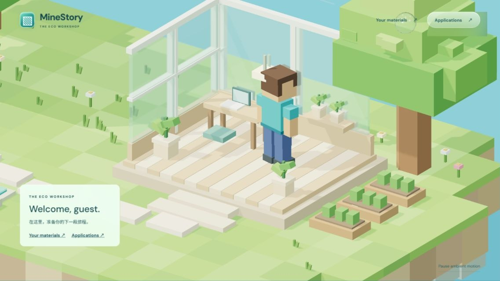
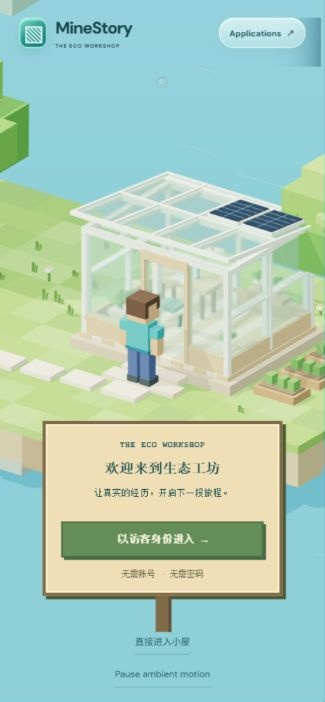
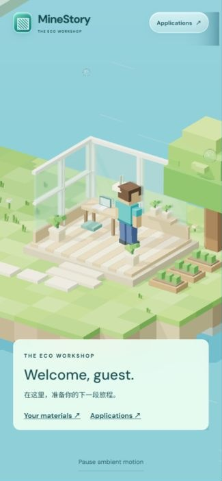

# MineStory · 阶段 B 连续体验验证

日期：2026-10-10。沿用独立分支 `codex/minestory-stage-a`，保留阶段 A 场景。当前用户请求优先于交接文档的后续阶段建议。

## 已实现

- 开场近景聚焦树下闭眼休息的人物，保留 Click to start 与简洁导航。
- 人物睁眼、抬头、起身，沿固定航点自动行走；手臂、腿部和身体使用关节动画。
- 镜头保持斜上方固定朝向，平滑跟随目标位置和缩放，不使用自由镜头或额外动画库。
- 门口等待访客确认，显示像素风告示牌；无登录、注册或新增账号接口。
- 进入时先打开门扇，人物穿过门口后隐藏屋顶、前墙和右墙，展示桌椅、绿植与人物所在的室内剖面。
- 状态机只允许合法顺序；重复启动、重复进入不会生成额外动画循环。跳过开场停在门口；直接进入立即显示室内。
- prefers-reduced-motion 下默认暂停环境动画，开始和进入均直接完成对应转场。动态偏好变化也会完成当前转场。环境暂停不阻断用户启动的行走。
- 同一页面往返上传/申请界面保留场景进度、资料 ID 和草稿。隐藏页面暂停计时；重载仍会清空原有页面内存数据。

## 验证

Windows Codex 内置浏览器实际操作，桌面约 1366×768、手机布局 390×843 CSS 视口。手机为浏览器尺寸模拟。截图仅裁掉内置浏览器缩放产生的页面外空白。

- 正常开始并连续到门口；起身、行走和跟随镜头可见。
- 启动双击与访客入口重复点击只产生一次转场，完成后保持 inside。
- 跳过开场立即出现访客告示牌；直接进入立即显示剖面。
- 手机访客入口、进入后的资料/申请导航可操作，人物和室内未被面板遮挡。
- 申请页输入临时草稿，返回场景保持 inside，再回申请页草稿仍在；检查结束清空临时内容。
- 场景控制台无错误。系统 reduced-motion 分支通过状态机测试；本轮未修改操作系统偏好进行浏览器媒体模拟。
- `node tests/workspace.test.mjs`：通过。覆盖原上传字段、限制、就绪状态、多申请、生成请求、状态轮询/下载地址和场景往返数据保持。
- `node tests/journey.test.mjs`：通过。覆盖流程顺序、路线边界、开门等待、重复点击、跳过/直接进入和 reduced-motion。
- `npm run build`：通过。`git diff --check`：通过。

未修改后端或接口；浏览器未上传个人文件、未调用实际生成服务。后端真实上传/AI 生成端到端验证仍待后端运行后进行。

## 关键画面

## 尚未完成

自由移动、碰撞系统、室内业务物体联动、账号与持久化历史均不在本轮范围。现有上传和申请继续通过原界面访问。阶段 A 的透明材质与几何合批优化也尚未实施。本轮未推送、合并或发布。
