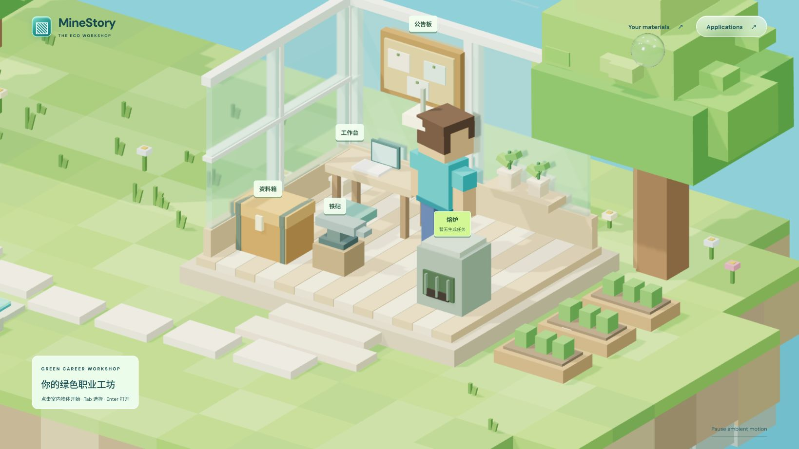
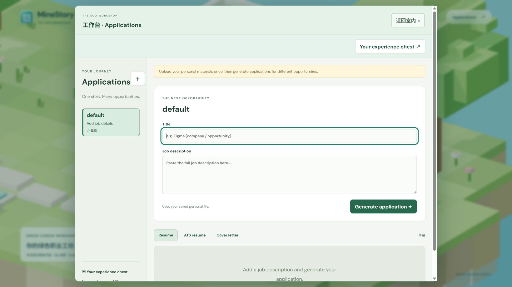
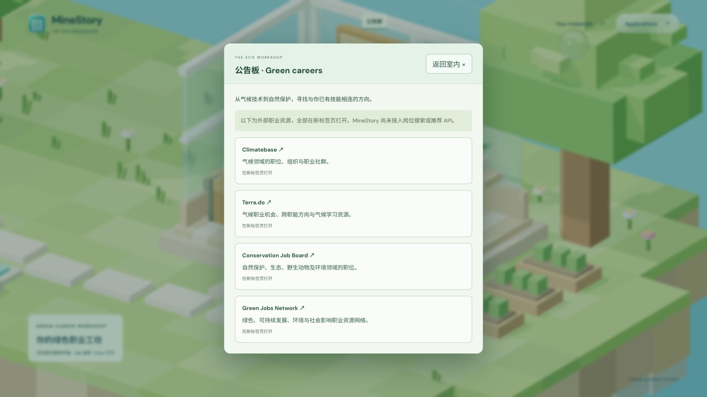
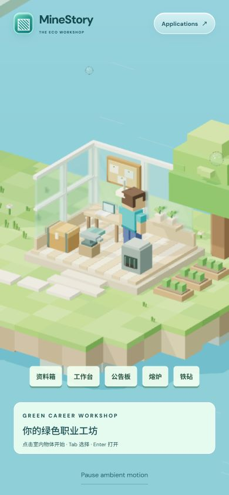
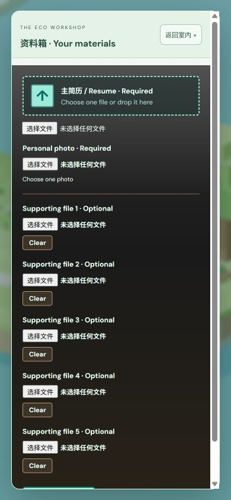
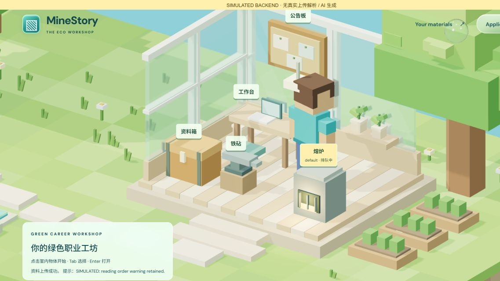
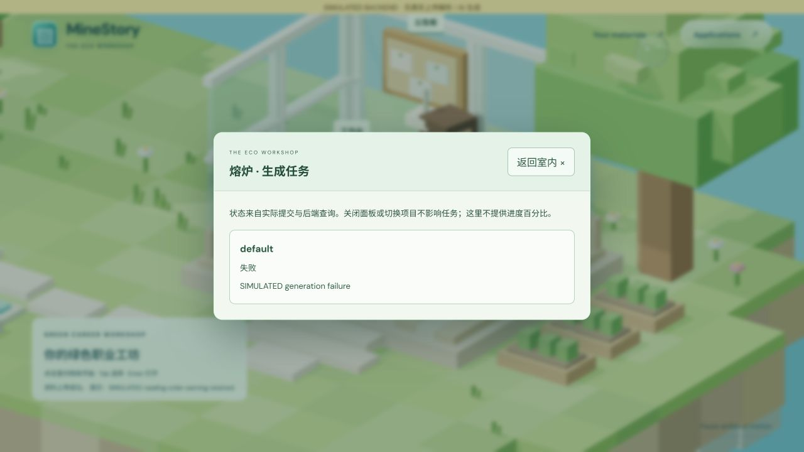

# MineJob · Stage C career workshop

Date: 2026-10-10. Historical branch: `codex/minestory-stage-a`; Stages A/B were preserved. No backend/API changes, push, merge or deployment occurred at that stage.

## Implemented at this stage

- Chest, workbench, noticeboard, furnace and anvil as Three.js models. Ray picking opens them, with synchronized hover/focus highlights and compact mobile shortcuts.
- Existing upload/workbench form nodes move into one native dialog and return afterward; state and listeners are preserved without duplicate forms.
- Chest retains resume, required photo, five supporting slots, multipart validation, errors and warnings. Success closes the panel/lid and restores focus; errors leave it editable. Selections survive closing.
- Workbench retains the initial default application, independent drafts and three download types. New labels use an inline form instead of a browser prompt.
- Noticeboard links to Climatebase, Terra.do, Conservation Job Board and Green Jobs Network, labelled as new tabs with noopener/noreferrer. No search API existed yet.
- Furnace follows all real task states. Queued/running lights it; completed/failed/unavailable status extinguishes it. Preparation/generation/validation use actual stages. Unknown status stays explicit; polling survives dialogs and application switching, with duplicate query guards and no progress percentages.
- Anvil only described unavailable model settings, without collecting keys or pretending to save.
- Native dialog focus handling and Esc/close return to the object. Scene controls pause while panels are open. Free movement was not implemented yet.

## Browser checks

Windows Codex in-app browser, desktop 1366×768 and 1639×922, simulated mobile 390×843. All five models and shortcuts opened their panels. Upload validation, editable failures, open lid and Esc focus restoration were checked. Production preview did not upload personal files or call AI.

Workbench drafts survived reopening, with one initial default. Four external links and new-tab labels were checked; handing links off did not prove external pages loaded. Anvil had no input/save action. Mobile panels, scrolling, new labels and close controls had no horizontal overflow.

## Explicit simulation

`tests/mock-preview.mjs` served a separate SIMULATED BACKEND on port 5175, using non-personal DOC/PNG fixtures. It changed the API address only in served copies; production remained at port 8000.

Simulated browser checks covered upload success, retained warnings, furnace states while dialogs closed or projects changed, readable failures, independent drafts and three corresponding download links. One explicitly simulated file was downloaded. Automated tests additionally covered validation stage, unknown status and duplicate polling. These checks did not prove actual document parsing, AI quality or a working generation environment.

## Regression

Workspace tests passed for the original contract, warnings, downloads, form relocation/restoration, focus, success/failure panel behavior, cross-application polling and stage mapping. Journey tests passed for ordering, routes, duplicate guards and reduced motion. Build and whitespace checks passed.

## Screenshots

These task screenshots are simulated, not evidence of real generation:

Movement, collision, accounts/persistence, model switching and job search were still pending at this stage. Reload cleared material IDs/drafts; real upload, task lifecycle and three DOCX downloads still required integration.
