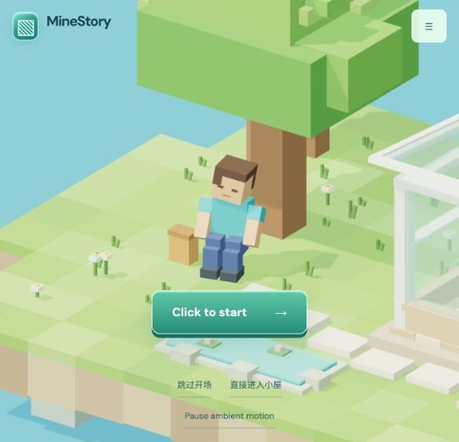
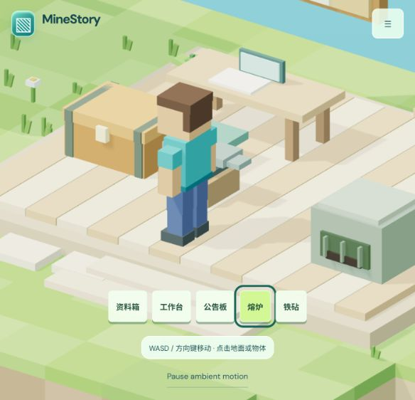
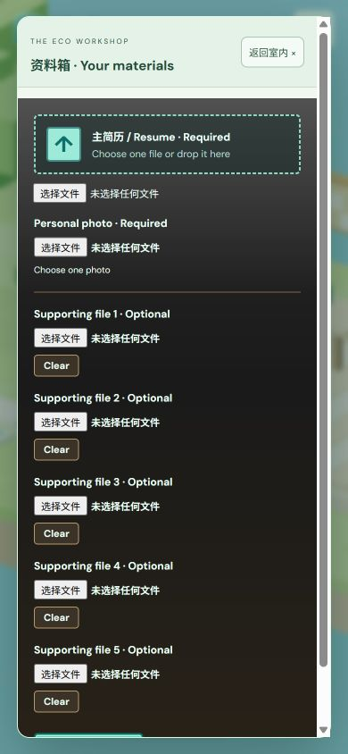
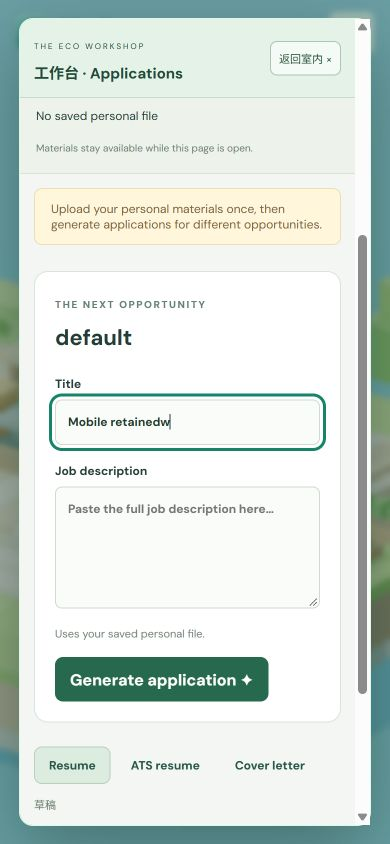

# Stage D · Character-centered workshop exploration

Date: 2026-10-10. Historical branch: `codex/minestory-stage-a`. At this stage, nothing was pushed or merged; the backend and `src/api.js` were unchanged.

## Reference and implemented behavior

The Bruno Simon site was inspected through its start, driving, collision, following camera, proximity hints and Circuit panel/menu. None of its models, assets, map or source code was reused.

Earlier stages left the indoor character stationary and opened objects immediately. Stage D expanded the cabin, repositioned furniture/plants, preserved the introduction/guest sign, and added:

- Camera-relative WASD/arrows with normalized diagonal speed and shoulder-inclusive character radius. Authored walls/furniture collide; small substeps prevent tunnelling and allow edge sliding.
- Click-model/shortcut path planning around furniture. Arrival faces the object and opens the existing panel. Mobile supports shortcuts and valid ground clicks. E/Enter interacts nearby; Esc cancels approach.
- Smooth following camera and cutaway walls/roof/pendant. Labels and models highlight together.
- Existing form nodes in native dialogs. Panels, blur, route changes and visibility changes clear held movement/routes; closing restores object focus. Drafts/materials/polling remain independent of travel.
- Distance-driven gait and smooth chest lid animation; reflective/transmissive glass and gentle water motion.
- Upper-right settings menu for low graphics/reduced motion without reload or lost state. Low mode uses DPR 1, no shadows and simplified transparency. Reduced motion retains active keyboard control while removing automatic travel/ambient animation.
- `prefers-reduced-motion`, `?motion=reduce`, `?quality=low` and `?view=2d`, plus existing form access after WebGL/context failure.
- Static ground instancing by material, with interactive models independently picked.

## Browser verification

Windows Codex in-app browser, with mouse/keyboard and viewport checks; mobile was simulated, not physical touch hardware.

The complete start/wake/stand/walk/guest/entry sequence worked. Keyboard movement stopped at furniture/bounds while the camera followed. Five object shortcuts approached before opening; the furnace model was also ray-picked directly. Upload slots remained intact; drafts survived reopening. Typing W in forms did not move the character. Esc restored chest/workbench focus. External noticeboard links, anvil notice and empty furnace state were checked.

At 390×844, chest/workbench panels scrolled without horizontal overflow and close remained usable. Graphics/motion toggles retained drafts; reduced-motion approach opened immediately. `?view=2d` verified the explicit fallback, without disabling hardware or simulating driver failure. System preferences were not modified.

## Performance observations

Two-second diagnostics exposed FPS, draw calls, DPR, quality and character position. Short samples are not hardware benchmarks.

| Conditions | Observation |
| --- | --- |
| Default 584×562, normal quality, DPR 1.5, shadows/glass transmission | 59–60 FPS; approximately 107–293 indoor draw calls as the view changed. |
| Actual 1066×600 CSS viewport, DPR 1.2, normal quality | 60 FPS; one 293-call sample. A requested 1280×720 was scaled by the desktop. |
| Simulated mobile 390×844, low quality, DPR 1 | 60–61 FPS; approximately 109–121 indoor calls; no horizontal overflow. |

A concurrent reference page produced 19 FPS, and viewport initialization briefly showed 1 FPS. Closing it/reloading restored the samples above. Approach timing was corrected for low-frame-rate travel while collision remained substepped.

No CPU/GPU throttling, physical-phone, weak-network or prolonged-load test was performed; no GPU model was read. Reduced motion stops idle rendering, so diagnostic FPS can retain an older value.

## Tests and limits

At that stage, four reported test entries, build and whitespace checks passed. Tests covered introduction ordering/bounds/door/duplicates/skip/motion, all-pairs furniture reachability, legal steps, long-move collision and cancellation. Business tests used mocked DOM/API for uploads, validation, warnings, form focus, independent drafts, downloads and background polling. Stage C simulation was not repeated.

Production browser checks did not upload personal material or call AI. A read-only local `/health` check timed out, so real parsing, full generation and three real DOCX downloads remained unverified. Empty panels or simulated screenshots were not generation evidence.

Outdoor free exploration, jumping and dynamic physics were pending at this stage. Indoor navigation used one fixed plane and authored furniture footprints; moving furniture required matching collision updates. No accounts, persistent history, model switching or job search API existed yet. Real low-end graphics and movement still required hardware testing.

## Screenshots

