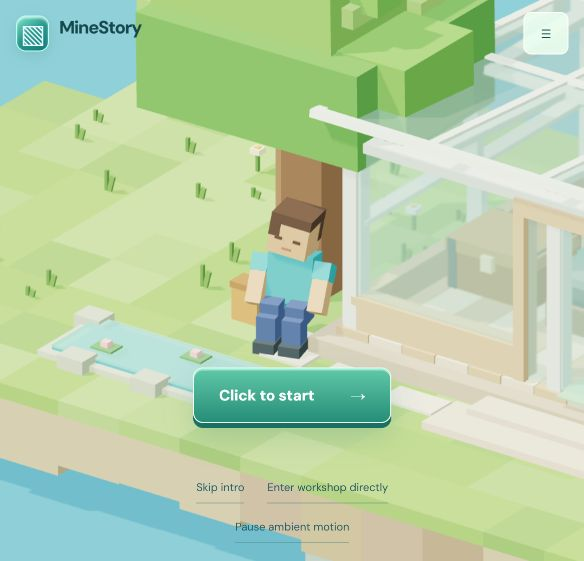
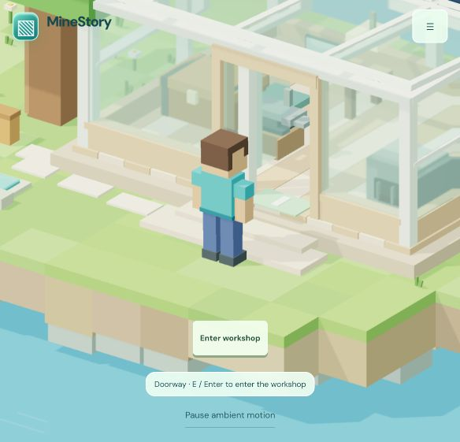
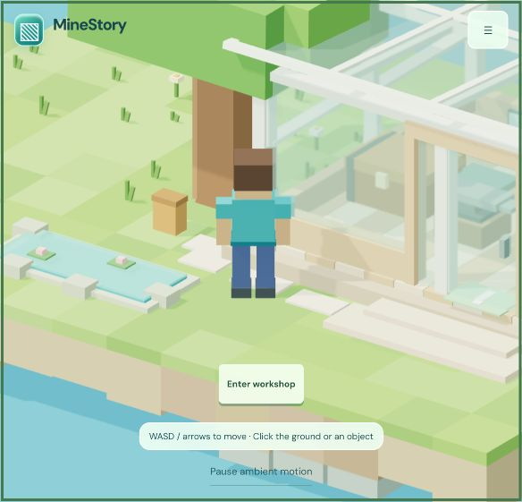
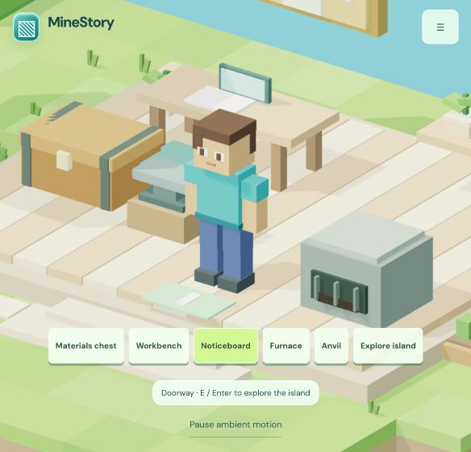
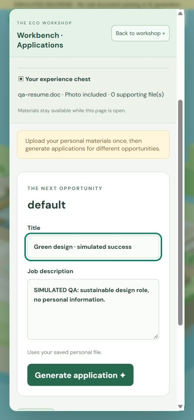

# 英文界面、短开场与小岛探索验收

日期：2026-10-10。分支：`codex/minestory-stage-a`。保留 A/B/C/D 的场景和业务实现；未修改后端，未推送、合并或提交。

## 本轮实现

- 所有应用自有开场、入口、表单、状态、错误、警告与降级文案改为英文。前端映射现有后端中文错误及动态 PDF 提取警告；未知中文错误显示英文通用说明。用户输入、文件名保持原样，系统文件选择窗口遵循操作系统语言。
- 树与树下起点移近小屋，同步缩短实体道路和自动路线。原步速 1.25 世界单位/秒保持不变，步行段约 4.18 秒；苏醒和站起另需约 2.4 秒。跳过和直接进入保留。
- 室内外共用导航与业务状态，通过门口退出和再次进入。原小岛地块构成探索边界，树干、池塘及岸沿、花坛、家具和建筑墙壁有碰撞；门口保留通路。可用 WASD、方向键或点击地面。镜头平滑调整室内外距离，必要时隐藏遮挡墙/屋顶、淡化挡住人物的树冠。
- 业务面板仍暂停角色控制；关闭时清空按键并恢复触发物焦点。出入不重播开场、不清空资料、申请和任务。

## 浏览器实测

生产配置 `http://localhost:5173/`：首次 Click to start、门牌访客进入、室内工作台、Esc、点击 Explore island、室外 A/W 移动、实体墙阻挡、点击草地自动步行、点击 Enter workshop 再次进屋。工作台中 `Island round trip` 草稿在出入后保留。点击草地实测由 (0.42, 3.03) 走至 (-3.37, 2.41)。浏览器错误日志为空。

独立模拟服务 `http://localhost:5175/`（SIMULATED banner）：使用无个人资料的 fixture 文件验证上传后自动关闭、再次打开仍有简历与照片、中文提取警告英文显示。生成失败任务后关闭面板、出屋、再次进屋，任务持续更新，中文超时错误英文显示。重试任务完成后，三个文档标签保留各自返回链接。表单内按 W 不移动；Esc 关闭后位置保持，焦点返回 Workbench，控制恢复。

390×844 浏览器视口检查英文工作台，表单在面板内部滚动、无横向溢出，关闭按钮可操作。临时视口已恢复。不是物理手机测试。

## 回归与构建

`node --test tests/*.test.mjs`：6 项全部通过。覆盖开场时序、重复触发、跳过、reduced-motion、自然步速与路线碰撞；家具路径、门口往返、岛岸/池塘/树干/墙体碰撞和防穿透；上传契约、验证、英文后端消息、独立草稿、下载链接、轮询和面板焦点。

`npm run build` 成功；`git diff --check` 通过（只有 Windows 换行提示）。没有新增依赖。

## 条件与仍存在的限制

性能观察来自 Windows 桌面 Codex 内置浏览器，正常质量、DPR 1.5、默认约 584×562 视口；本轮多标签并行与模拟任务检查时约 37–43 FPS、272–393 draw calls，其他阶段观察约 50–61 FPS。未人工限制 CPU/GPU、未测 GPU 型号、真机、弱网或长时间热负载；不是性能基准。

生产配置没有提交真实个人资料或运行真实 AI 生成。模拟服务仅验证 UI 与状态保存；真实文件解析、AI 任务和真实 DOCX 下载仍需后端联调。模拟检查不代表真实生成成功。

仍无账号、刷新后的历史持久化、模型切换、岗位搜索或推荐 API；没有扩建岛屿、跳跃或动态物理系统。导航使用作者定义的静态碰撞范围，移动家具时要同步范围。极低性能设备上的透明材质成本仍需真机验收。Stage D 文档中的“未实现室外探索”描述属于上一阶段，本轮已实现。

## 截图

